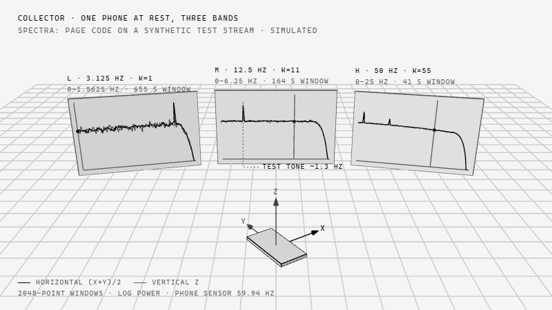

<picture>
  <source media="(max-width: 600px) and (prefers-color-scheme: dark)" srcset=".github/assets/hero-mobile-dark.svg">
  <source media="(max-width: 600px)" srcset=".github/assets/hero-mobile-light.svg">
  <source media="(prefers-color-scheme: dark)" srcset=".github/assets/hero-dark.svg">
  
</picture>

<picture>
  <source media="(max-width: 600px) and (prefers-color-scheme: dark)" srcset=".github/assets/rule-mobile-01-dark.svg">
  <source media="(max-width: 600px)" srcset=".github/assets/rule-mobile-01-light.svg">
  <source media="(prefers-color-scheme: dark)" srcset=".github/assets/rule-01-dark.svg">
  
</picture>

The QuakeScore collector is a single web page that records how a building vibrates, using a phone
lying flat and still inside it. It reads the phone's motion sensor while the page is open, turns the
readings into averaged vibration spectra on the phone, and saves one small file at the end. The page
sends nothing anywhere. You save the file yourself and decide whether to pass it on.

It is an early prototype. It has been driven only with simulated sensor events and has never been
run on a real phone.

**Open it on a phone:** https://hesselb20-ctrl.github.io/quakescore-collector/

<picture>
  <source media="(max-width: 600px) and (prefers-color-scheme: dark)" srcset=".github/assets/rule-mobile-02-dark.svg">
  <source media="(max-width: 600px)" srcset=".github/assets/rule-mobile-02-light.svg">
  <source media="(prefers-color-scheme: dark)" srcset=".github/assets/rule-02-dark.svg">
  
</picture>

**The problem.** [QuakeScore](https://github.com/hesselb20-ctrl/quakescore) estimates a building's
vibration from phones at rest inside it. Every result in that project so far comes from a simulator.
The next step is a first real night in a real building.

**What was missing.** A way to record that night on an iPhone, or on any Android phone, without
installing an app. The QuakeScore Android app has never been installed on a device, and the iOS app
is a skeleton.

**Who it is for.** Anyone taking part in a QuakeScore field test. The page asks for a building name
and a floor, and produces the same session file format that the QuakeScore server reads.

This repository is the hosted copy. The five page files are byte-identical to
[`web/collector/`](https://github.com/hesselb20-ctrl/quakescore/tree/main/web/collector) in the
QuakeScore repository, which also holds the tests.

<picture>
  <source media="(max-width: 600px) and (prefers-color-scheme: dark)" srcset=".github/assets/rule-mobile-03-dark.svg">
  <source media="(max-width: 600px)" srcset=".github/assets/rule-mobile-03-light.svg">
  <source media="(prefers-color-scheme: dark)" srcset=".github/assets/rule-03-dark.svg">
  
</picture>

<picture>
  <source media="(max-width: 600px) and (prefers-color-scheme: dark)" srcset=".github/assets/flow-mobile-dark.svg">
  <source media="(max-width: 600px)" srcset=".github/assets/flow-mobile-light.svg">
  <source media="(prefers-color-scheme: dark)" srcset=".github/assets/flow-dark.svg">
  
</picture>

1. **Set up.** The user types a building name and a floor and ticks whether the phone is charging.
   On iPhone the page asks for motion permission on that tap. The building is stored as
   `test:<name>`.
2. **Read the sensor.** The page listens to `devicemotion` and takes acceleration including
   gravity on three axes. A pause of more than 2 seconds in the stream, for example when the phone
   locks or another app comes to the front, ends the session.
3. **Fix the rate.** The first 10 seconds measure the sensor rate. Readings are then resampled onto
   a 100 Hz grid, or 200 Hz if the sensor delivers 190 readings a second or more.
4. **Split into bands.** Linear-phase FIR filters decimate the grid into three bands at 50, 12.5 and
   3.125 samples a second.
5. **Warm up and gate.** The first 120 seconds set the reference level of motion and the direction
   of gravity. If the phone is not flat, the session stops. Each later second with too much motion
   or tilt is set aside, and a long run of such seconds ends the session.
6. **Average spectra.** Each band is cut into 2048-point Hann windows. Only windows without a
   set-aside second are kept, and their spectra are averaged. Raw readings are not stored.
7. **Save.** "Stop and save" builds one JSON file, upload schema v1, named
   `quakescore_test-<name>_<UTC date>_<time>.json`. It is saved as a download or through the share
   sheet. While recording, a snapshot is kept in the browser's local storage every 60 seconds, so
   "Save the last session again" can recover it.

<picture>
  <source media="(prefers-color-scheme: dark)" srcset=".github/assets/scene-dark.gif">
  
</picture>

<sub>The three bands and 2048-point windows are the constants in `dsp.js`. The spectra are what this
page's code produced from the synthetic test stream `stream_c` in the QuakeScore repository, not a
real building. The test tone is part of that synthetic stream.</sub>

<picture>
  <source media="(max-width: 600px) and (prefers-color-scheme: dark)" srcset=".github/assets/rule-mobile-04-dark.svg">
  <source media="(max-width: 600px)" srcset=".github/assets/rule-mobile-04-light.svg">
  <source media="(prefers-color-scheme: dark)" srcset=".github/assets/rule-04-dark.svg">
  
</picture>

What the code does today. All of it has been checked with simulated input only.

- **Page and controls.** Setup, live readout, a dimmed night screen with a clock, save, share and
  recovery. Keeps the screen awake with the Screen Wake Lock API where the browser has it.
  `index.html`, `app.js`
- **Signal processing.** Rate probe, resampling, FIR decimation, levelling, movement gate, FFT and
  per-band averaging. A port of the QuakeScore Android code, with no dependencies. `dsp.js`
- **Filter taps.** Generated in the QuakeScore repository, not edited by hand. `fir_taps.js`
- **Session file.** Builds the schema v1 file and the file name, estimates the sensor's step size,
  and computes the live phone noise reading in µg/√Hz. `session_file.js`
- **Privacy.** No network calls: the only imports are the page's own files. No location, no sound,
  no raw recording. Local storage holds a random secret used to derive a per-building contributor
  id, the last building name, and the session snapshot. `app.js`

Checked while writing this README: the QuakeScore signal-processing test passes against the Python
reference vectors, and two session files written by the same code were accepted by the server's
upload codec (`quakescore/service/codec.py`, `validate` and `decode`).

[`collector.png`](collector.png) shows the real page's three screens (set up, recording, finished)
fed with simulated sensor readings.

**Known limits**

- Never run on a real phone. Real sensor delivery on iOS and Android, how long a phone keeps the page
  awake, and battery cost are unknown.
- Browsers deliver about 60 readings a second with coarse timing. The top band is noisier for that
  reason.
- The page must stay open and in front with the screen on. On iPhone, Auto-Lock may need to be set to
  Never.
- There is no clock synchronisation. The file says `sync_source: "none"`.
- The floor is typed by hand. Battery level is recorded only where the browser exposes it.
- One night from one phone usually shows the phone's own noise level and rarely a building mode.
  It is a screening measurement, not an engineering assessment of any building.

<picture>
  <source media="(max-width: 600px) and (prefers-color-scheme: dark)" srcset=".github/assets/rule-mobile-05-dark.svg">
  <source media="(max-width: 600px)" srcset=".github/assets/rule-mobile-05-light.svg">
  <source media="(prefers-color-scheme: dark)" srcset=".github/assets/rule-05-dark.svg">
  
</picture>

On a phone, open https://hesselb20-ctrl.github.io/quakescore-collector/. That step was not run
here, because no phone was available. Browsers give motion data only to pages served over https or
from localhost.

Commands below were run on Windows 11 with Python 3.15 and Node 26.

Serve the page locally from a clone of this repository, then open `http://127.0.0.1:8765/`. Here it
returned `index.html` with status 200, and in a desktop Chromium browser the page loaded with the
title `QuakeScore collector web-0.1.0` and no console errors. A desktop has no motion sensor, so a
session cannot be recorded this way.

```bash
python -m http.server 8765
```

Check that the hosted page matches this repository. Expect no output from `cmp`.

```bash
curl -s https://hesselb20-ctrl.github.io/quakescore-collector/ | cmp - index.html
```

The tests live in the [QuakeScore repository](https://github.com/hesselb20-ctrl/quakescore), not
here. Run from its root, the signal-processing check ends with `ALL PASS`, and the session-file
check writes two session files of about 197 kB each into the folder you name.

```bash
node web/collector/test_dsp.mjs
node web/collector/test_session_file.mjs <output folder>
```

Reading session files on a computer with `experiments/inspect_sessions.py` is described in the
[collector README](https://github.com/hesselb20-ctrl/quakescore/blob/main/web/collector/README.md).
It was not run here.

<picture>
  <source media="(max-width: 600px) and (prefers-color-scheme: dark)" srcset=".github/assets/rule-mobile-06-dark.svg">
  <source media="(max-width: 600px)" srcset=".github/assets/rule-mobile-06-light.svg">
  <source media="(prefers-color-scheme: dark)" srcset=".github/assets/rule-06-dark.svg">
  
</picture>

**Stack**

| Layer | Built with |
|---|---|
| Page | HTML and CSS, one file |
| Logic and signal processing | Plain JavaScript modules, no dependencies, no build step |
| Browser APIs | DeviceMotion; optional Screen Wake Lock, Battery Status, Web Share, local storage |
| Hosting | GitHub Pages, served from the repository root |

**Status**

| Part | State |
|---|---|
| Hosted page | Live, identical to `index.html` here |
| Signal processing | Matches the Python reference on three simulated test streams |
| Session file | Accepted by the QuakeScore server codec in a local check |
| Real phones | Never run on one |
| Tests | In the QuakeScore repository only |

**Roadmap.** The repository states no roadmap of its own. The collector README in QuakeScore names
what is still unchecked, which is what the first real night is for: real sensor delivery on iOS and
Android, how long a phone keeps the page awake, and battery cost.

**Documents**

| File | Contents |
|---|---|
| [`collector.png`](collector.png) | The page's three screens, fed with simulated sensor readings |
| [`web/collector/README.md`](https://github.com/hesselb20-ctrl/quakescore/blob/main/web/collector/README.md) | Collector status, use, limits compared with the Android app |
| [`quakescore/service/codec.py`](https://github.com/hesselb20-ctrl/quakescore/blob/main/quakescore/service/codec.py) | The upload schema v1 the session file follows |

To update the hosted page, copy changed files from `web/collector/` in QuakeScore into this
repository.

<picture>
  <source media="(max-width: 600px) and (prefers-color-scheme: dark)" srcset=".github/assets/rule-mobile-07-dark.svg">
  <source media="(max-width: 600px)" srcset=".github/assets/rule-mobile-07-light.svg">
  <source media="(prefers-color-scheme: dark)" srcset=".github/assets/rule-07-dark.svg">
  
</picture>

No license file yet. All rights reserved until one is added.
