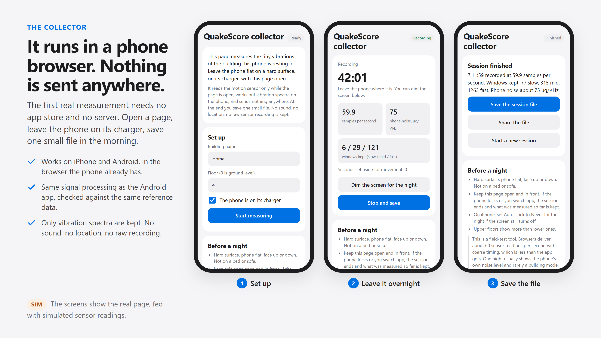

# QuakeScore collector

A web page that measures the tiny vibrations of a building with a phone lying still inside it.

**Open it on a phone: https://hesselb20-ctrl.github.io/quakescore-collector/**

## How to use it

1. Open the page on the phone. Type a building name and the floor.
2. Put the phone flat on a hard surface, on its charger, and press "Start measuring". On iPhone,
   allow motion access when asked.
3. Leave the page open and in front for the night. "Dim the screen for the night" shows a black
   screen with a small clock. On iPhone, set Auto-Lock to Never for the night.
4. In the morning press "Stop and save", then save or share the session file.

If the phone locks or another app comes to the front, the session ends there and what was measured
so far is kept.

## What it records

The page reads the phone's motion sensor while it is open, works out averaged vibration spectra on
the phone, and keeps only those. It sends nothing anywhere: there is no server behind this page.
It asks for no location, records no sound and stores no raw sensor recording. The result is one
small file that you save yourself and decide whether to share.

## What to expect

This is a field-test tool, part of a research project on how buildings respond to earthquakes.
Browsers deliver about 60 sensor readings a second with coarse timing. One night usually shows the
phone's own noise level and rarely the building itself. It is a screening measurement, not an
engineering assessment of any building.

The screens in the picture show the real page, fed with simulated sensor readings.
